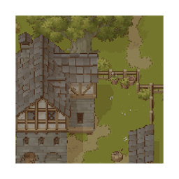
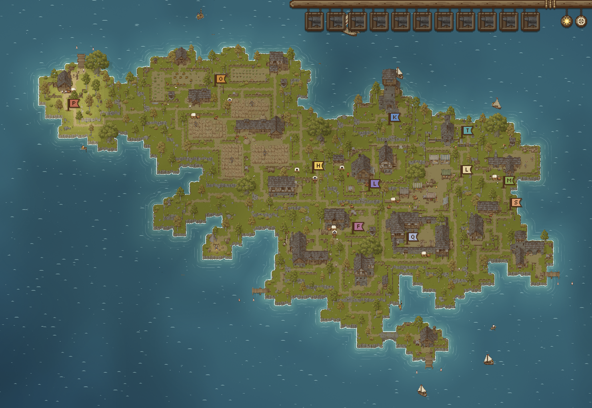
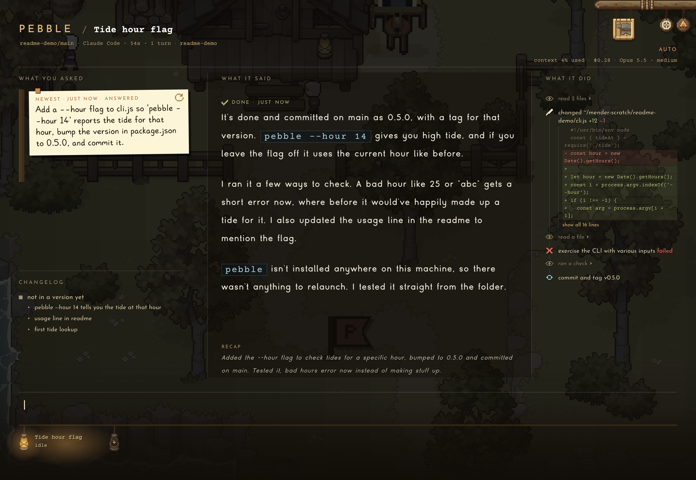
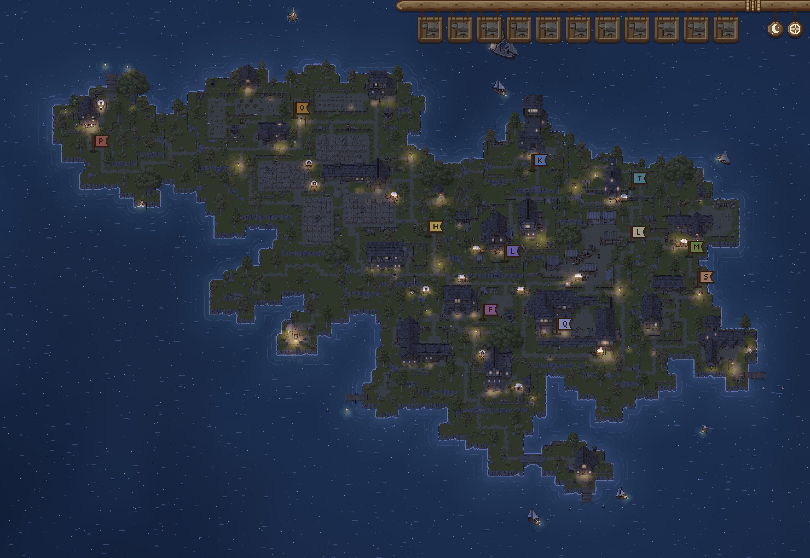
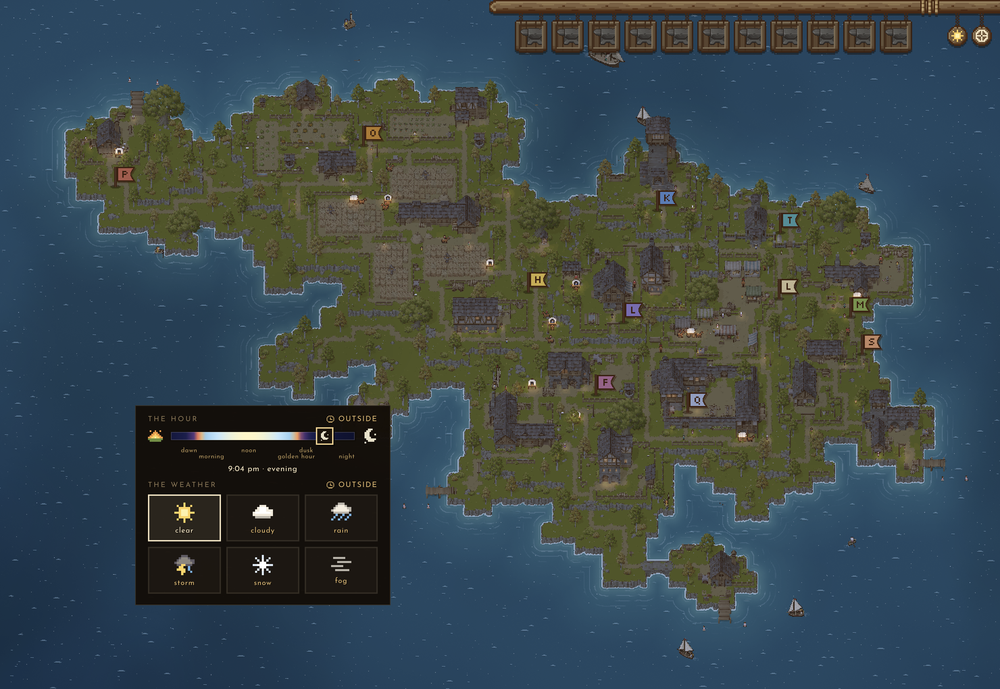

<div align="center">



# Mender

### *መንደር* · a village of coding agents

**Run Claude Code and friends in parallel, and watch them work in a living pixel-art village.**

[-c8a04a?style=for-the-badge&logo=apple&logoColor=white&labelColor=2b2118)](https://github.com/ktesfaye/mender/releases/latest)


[](LICENSE.md)

<br />



</div>

<br />

Mender is an agentic coding environment whose whole interface is a village on an island.
**Every project is a district. Every agent session is a villager.** What the villager is doing
tells you, from across the room, whether it's working, waiting on you, finished, or broken.

There's no sidebar, no tab strip, no title bar full of buttons. You open a project and the
camera flies in, the village dims to night, and the conversation is written straight onto it.
The village keeps living behind whatever you're reading.

<br />

<table>
<tr>
<td width="50%" valign="top">

### 🏝️ &nbsp;The island is your work
Projects move into the artist's districts and fly their own flag. A district that's busy fills
with townsfolk and carts; one nobody has touched in weeks grows over with moss and weeds.

</td>
<td width="50%" valign="top">

### 🏮 &nbsp;Lanterns, not badges
Each session hangs a lantern on the rail. Lit and breathing while it works, flickering orange
when it wants you, green when it finished something you haven't seen. No spinners, no dots.

</td>
</tr>
<tr>
<td width="50%" valign="top">

### 🔥 &nbsp;Real agents, real worktrees
Underneath is a full agent runtime: Claude Code over ACP, terminals, git and worktrees,
file search, PRs. Sessions share the project folder or get an isolated copy on their own branch.

</td>
<td width="50%" valign="top">

### ⏳ &nbsp;It watches your limits
Mender reads your five-hour window, warns when a session is burning it far faster than
normal, and waits out a usage limit on its own, carrying on the moment it lifts.

</td>
</tr>
</table>

<br />

<div align="center">

<sub>Inside a project. What you asked on the left, the answer in the middle, everything it did on the right, and its sessions as lanterns along the bottom.</sub>
</div>

<br />

## ✨ What it does

- **Parallel sessions** in one project folder, or each in its own worktree on its own branch.
- **Readable answers.** Markdown is drawn, not dumped: headings, tables, code slates, mermaid diagrams, pictures inline.
- **A plain-language trail** of what the agent did. "Built it", "tests passed", "committed: …", not raw shell commands.
- **Ask-back questions** from Claude rendered as proper choices you answer with the keyboard.
- **Checkouts on the board.** Read diffs, comment on a line, commit, push, pull, open and land PRs, resolve merges.
- **A real terminal** in every checkout (vim, tmux, htop all work), kept alive across restarts.
- **Usage awareness.** Context fill, cost, the five-hour window, and a runaway-session alarm.
- **Notifications** when someone needs you while you're looking elsewhere, and a recap of what you missed when you're back.
- **A real sky.** Your local time and weather, with lamplight, rain, snow and fog drawn per pixel.

<br />

<table>
<tr>
<td width="50%"></td>
<td width="50%"></td>
</tr>
<tr>
<td align="center"><sub>After dark the lamps come on one by one.</sub></td>
<td align="center"><sub>Your real local time and weather, or pick your own.</sub></td>
</tr>
</table>

<br />

## 🚀 Getting started

### 1. Install the tools Mender leans on

Mender drives the agent CLIs you already use, so it needs them on the machine:

```sh
brew install git gh ripgrep tmux node
curl -fsSL https://claude.ai/install.sh | bash   # skip if Claude Code is already installed
claude                                            # sign in once, the way you normally would
```

Mender signs agents in exactly the way your terminal does. If your shell profile sets up a token,
Bedrock, Vertex, a gateway, a proxy or extra certificates, Mender passes all of it through.

### 2. Download and install

Grab **`Mender-arm64.dmg`** from the [latest release](https://github.com/ktesfaye/mender/releases/latest),
open it and drag Mender into Applications.

Mender isn't notarised yet, so macOS will refuse to open it the first time. Clear that once:

```sh
xattr -dr com.apple.quarantine /Applications/Mender.app
open /Applications/Mender.app
```

> [!TIP]
> On a managed Mac where `/Applications` is locked, drag it into `~/Applications` instead and
> run the same command against that path.

Or from the terminal, using your GitHub login:

```sh
gh release download --repo ktesfaye/mender --pattern 'Mender-arm64.dmg' --dir ~/Downloads
hdiutil attach ~/Downloads/Mender-arm64.dmg
cp -R /Volumes/Mender*/Mender.app ~/Applications/
hdiutil detach /Volumes/Mender*
open ~/Applications/Mender.app
```

### 3. Found your first project

You'll land on a small island with a campfire. Click the fire, or press <kbd>⌘</kbd> <kbd>N</kbd>,
and pick a folder, clone a repo, or start a brand-new one. It moves into a district.
Walk in and start talking.

<br />

## ⌨️ Keys worth knowing

| Keys | What it does |
| --- | --- |
| <kbd>⌘</kbd> <kbd>K</kbd> | Find anything |
| <kbd>⌘</kbd> <kbd>T</kbd> | Start a session |
| <kbd>⌘</kbd> <kbd>N</kbd> | New session with options, or found a project out on the island |
| <kbd>⌘</kbd> <kbd>U</kbd> | Go to whoever wants you most |
| <kbd>⌘</kbd> <kbd>⇧</kbd> <kbd>T</kbd> | Bring back the session you just closed |
| <kbd>Tab</kbd> / <kbd>⇧</kbd> <kbd>Tab</kbd> | Next / previous session on the rail |
| <kbd>/</kbd> | Commands, skills, `/model`, `/mode`, `/effort` |
| <kbd>@</kbd> | Name a file in the checkout |
| <kbd>Esc</kbd> | Stop the agent, or step back one level |
| <kbd>⇧</kbd> <kbd>Esc</kbd> | Straight out to the island |
| <kbd>⌘</kbd> <kbd>,</kbd> | Settings (the windmill), where every key can be rebound |

<br />

## 🛠️ Building from source

```sh
git clone git@github.com:ktesfaye/mender.git
cd mender
pnpm install                          # provisions the pinned node and pnpm itself

pnpm --filter @emdash/mender dev      # run it in development
cd apps/mender && pnpm run package    # build Mender.app and a dmg into apps/mender/release/
```

The only prerequisite is `pnpm` on your PATH. Running `pnpm run dev` from inside a Claude Code
session? Prefix it with `env -u ELECTRON_RUN_AS_NODE`, since Claude Code's shell sets a flag that
makes Electron start as plain Node.

<details>
<summary><b>How the repo is laid out</b></summary>

<br />

| Path | What lives there |
| --- | --- |
| `apps/mender/` | The app: Electron shell, the wire to the runtimes, and the Pixi renderer |
| `apps/mender/assets/` | The packed sprite kit, the board's timber, the villagers, the fonts |
| `packages/village/` | The world model: districts, the shore pass, no drawing and no Electron |
| `packages/core/`, `packages/plugins/` | The agent runtimes and provider plugins, inherited from Emdash |
| `MENDER.md` | The full design: how every part of the village behaves and why |
| `docs/mender/STATE.md` | How far along everything is |

</details>

<br />

## 🌱 Where it comes from

Mender is a fork of [**Emdash**](https://github.com/generalaction/emdash) by General Action, Inc.
It keeps Emdash's entire back end (the agent runtimes, git and worktrees, terminals, search and
the wire protocol) and replaces the whole front end with the village. Upstream improvements to
the runtime keep flowing in; its UI never does.

The island is drawn with the [Pixel Art Top Down - Village](https://cainos.itch.io/pixel-art-top-down-village) kit by Cainos,
which are purchased and not redistributable. The villagers are Mender's own. Agent answers are set
in Grunell, whose free cut is for personal use only.

## 📄 License

Code is licensed under [Apache-2.0](LICENSE.md), Copyright 2026 General Action, Inc. and
contributors. The art and fonts above are under their own licences.

<div align="center">
<br />
<sub>Made with ☕ and a lot of lanterns.</sub>
</div>
