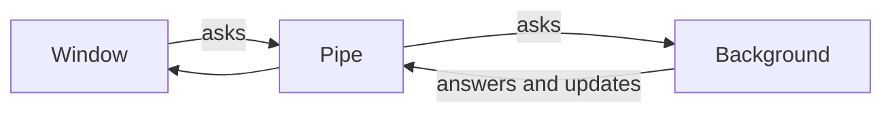
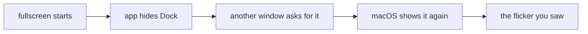

# What an answer should look like

A plan, not a rule. Nothing here is written into any prompt yet. The examples are made up to
show the shape; the facts and links in them are placeholders, so a picture in
one won't load. Each scenario
below is a kind of question Kirubel actually asks, taken from his own sessions,
and each is drawn two or three different ways as a real answer would be, so
they can be looked at on the board and picked from. Where a variation needs
the board to learn something it can't draw today, it says so under it.

## What the research said, in short

Every vendor that builds these assistants defaults to plain talk and treats
structure as something the content has to earn. Anthropic's own guidance swung
from "avoid lists, headers and bold" to "use structure when the content is
multifaceted" after finding its models had overused it, and warns that a
blanket rule either way breaks things. OpenAI turns markdown off by default.
Google's generated pages beat plain markdown on preference, but only for
questions about things, places, products and data, never for a chat turn.

Models over-format because the preference data they're trained on rewards
lists and bold far more than people actually do. So a model's urge to make a
table is suspect on its own.

The reading research is web pages, not chat, but it is solid on a few points.
Lead with the answer. Fewer words helped more than formatting did. Detail
should be pulled on demand, at most one fold deep.

From information design, the form follows the shape the content already has: a
set, a sequence, a hierarchy, things passing between parts, a change, a place,
an argument. Name the shape first. If there isn't one, it's sentences.

From his own sessions: answers to a fix or a tweak are already fine as two
plain sentences, and he has never complained about one. Every complaint about
form lands on explaining, comparing, "where is it at", recommendations, and
research with sources. That is where the variations below spend their effort.

## The scenarios

---

### 1. Something got fixed or done

He asked for a change and it's in. The most common thing he hears.

**A. Two sentences.** What's different now, and that it was checked.

Shuffle deals the whole favourites list now, not just what had loaded. Tried
it on the phone with a long list and it went all the way through.

**B. One line and the before and after he'll see.** When the change is visible
and easy to misjudge.

The name on a lantern isn't cut short any more.

| before | now |
|---|---|
| Fix the dock hid… | Fix the dock hiding on fullscreen |

**C. A short checklist with states.** Only when several separate things moved
and one of them couldn't be tested.

Three bits of the paste fix:

- ✓ a pasted X link plays in the app
- ✓ a pasted YouTube link still works
- ✗ couldn't try a private X post, nothing to test it on

*Needs the board:* a tick and a cross that read as marks, in the done green and
the sore red, rather than characters.

---

### 2. How is this put together

"How is this repo put together, and which bit talks to which?"

**A. Sentences with one picture at the point it explains.** The default.

It's two halves that only talk through one pipe. The background side owns
git, the agents and the files, and the window side only draws.



The bit that bites is that the window never touches a file itself, so
anything new has to go through that pipe first.

**B. A tree, when what he wants is where things are, not how they talk.**

```
mender
├── apps/mender        the app itself
│   ├── main           background side, git, agents, files
│   └── renderer       the island and the boards
└── packages
    ├── core           emdash's engine, untouched
    └── village        the map rules, draws nothing
```

Almost everything you'd change lives under the renderer.

**C. The gist, then the rest folded.** When there's a lot and he may only want
the top.

Two halves, one pipe between them, and the window only ever draws.

- ▸ what each half owns
- ▸ how a message gets from one to the other
- ▸ where to look when you want to change X

*Needs the board:* a fold that opens in place when pressed, one level only.

---

### 3. Where is this at

"Tell me the state this app is at now, what features does it have." The one
that went wrong today.

**A. Grouped, by area, in a few lines each.** Nothing dropped, just sorted.

It's a working coding app with no chrome. Projects are districts, each
session is a real Claude Code in that checkout, and the whole day's work
happens on wood over the village.

**A session.** Real Claude in the project's folder or its own worktree,
resumes across restarts, names itself. Questions answered by number key,
usage limits drawn as a wait, helpers you can walk up to. Thin on thinking
and plan cards, which no real turn has sent yet.

**The work.** Diffs, commits, branches, merges and pull requests all from the
board, plus two real shells per checkout. HTML and SVG files still read as
plain text.

**The island.** …and so on, one short paragraph per area.

**B. What works and what's thin, side by side, per area.**

**A session**

| works | thin |
|---|---|
| real Claude, resumes, names itself | thinking and plan cards unseen |
| questions by number key | transcript untested at huge lengths |
| limits drawn as a wait | no maths in markdown |

*Fails when* the cells grow into sentences. Keep it to a few words a cell or
use A.

**C. What changed lately, then where it stands.** When he's been away and
wants to catch up rather than a full inventory.

Last two weeks, newest first:

- questions with answers you pick from the keyboard
- usage limits drawn as a wait that ends by itself
- projects put away on the rack
- pictures you can hold up big

Under all that, about three quarters of what was meant to be built is in and
driven.

---

### 4. Compare these

"Compare An Echo of Things to Come with A Show of What Was Lost." "How does
this differ from Lightroom Classic."

**A. The verdict first, then the few points they differ on.**

Echo is the bigger, slower book, and Show is the one that pays it off.

| | Echo | Show |
|---|---|---|
| pace | slow build | relentless |
| scale | one city | the whole continent |
| ending | a cliff | a landing |

**B. Each one in its own column, in its own words.** When they're different
characters rather than the same thing scored.

| Echo | Show |
|---|---|
| Politics and a slow fuse. Most of it is set-up you only feel at the end. | Everything the first two built goes off at once. Less room to breathe, more payoff. |

*Needs the board:* two real columns side by side that wrap, rather than a table
pretending to be them.

**C. Where they agree, where they part.**

Both: the same narrator, the same magic, the same habit of a quiet chapter
right before it goes bad.

Different: Echo is about one city holding together, Show is about the whole
map coming apart.

---

### 5. Recommend me something

Places, books, products, things to do.

**A. Each pick as a card.** Its picture, its name linked, one line on why.

 [Dooky Chase's](https://…) for the gumbo, and
because it's where the civil rights movement ate.

 [Willie Mae's](https://…) for the fried chicken,
go before noon or queue.

The board already draws a picture beside its list entry. *Could be better:* a
real card with the picture, name and line held together as one thing.

**B. One pick, then the rest.** When he wants to be told.

Go to [Dooky Chase's](https://…). If it's closed, [Willie Mae's](https://…),
and if you want somewhere quieter, [Liuzza's](https://…).

**C. Grouped by what kind of time he wants.**

If you want history, …
If you want a long lunch, …
If you've got an hour, …

---

### 6. How do I do this

Steps he'll actually follow, usually on his own hands.

**A. Numbered, with what to type right under the step it belongs to.**

1. Turn on wireless debugging on the phone.
2. Find its port.

```
adb mdns services
```

3. Connect to it with that port.

**B. One line, when it's one step.** Don't number a list of one.

Run `pnpm install` in the repo, that's the whole setup.

---

### 7. He has to choose

A fork only he can call.

**A. Put it on the question board.** The board already draws Claude's own
questions with answers to pick from the keyboard, each answer with what it
means under it and the recommended one marked. A choice in prose is a choice
buried.

**B. In sentences, with the pick said first.** When it's two options and the
reasons are short.

I'd keep it in the project's own folder. A worktree only helps when two
sessions edit the same files at once, and you rarely do.

---

### 8. What is this

"Whats yakamein?" A quick thing he wants to know.

**A. A couple of sentences and a picture of it.**

 A beef noodle soup New Orleans sells from corner
stores and second lines, salty and spicy, sworn to cure a hangover. Locals
call it Old Sober.

**B. The same, plus where to get it.**

…and [Ms. Linda's](https://…) is the one people send you to.

---

### 9. Personal

Something on his mind, not a task.

**Only one way.** Plain talk, no shape at all, ever. The research is unanimous
on this one, and it's the case where a list would feel coldest.

---

### 10. Why is this happening

A diagnosis.

**A. The finding in sentences, with the one bit of evidence shown.**

It's the Dock. The app hides it the moment fullscreen starts, and macOS
brings it straight back because another window asked first. That's why it
flickers instead of staying gone.

**B. The chain, drawn.** When it's several steps from cause to what he saw.



---

### 11. Look this up for me

Research with sources, where being sure matters: what's open near him, what a
card covers, prices, deadlines.

**A. The answer first, then each item with its link and how sure.**

[Walgreens on Broadway](https://…) is open till midnight and has Afrin, I
checked its page. [CVS on Pike](https://…) says 24 hours but reviews from this
week say it shuts at ten, so I'd not bet on it.

**B. A table, but only when the rows really line up on the same few points.**

| | open till | has it | how far |
|---|---|---|---|
| [Walgreens Broadway](https://…) | midnight | yes | 6 min |
| [Bartell Pike](https://…) | 10pm | yes | 9 min |

*Could be better:* a small map with the places on it. The board can't draw one;
a picture of one or a link is the stand-in.

---

## What the board would have to learn

Only for the variations that need it, none of which is decided yet.

| | for | why |
|---|---|---|
| a fold | how it's put together, where it's at | detail on demand, one level |
| marks that read as marks | something got done | done and couldn't-test, at a glance |
| two columns that wrap | compare | two characters, not a scored grid |
| a card | recommend | picture, name and why held together |

## What happens next

He picks, per scenario, which of these feel right, or none. Only then does
anything go into a prompt, and it goes in as the reasoning behind the picks
with these examples kept as examples, not as a list to recite.
