# Driven through the running app

Build: Mender at HEAD `4fbfa1270` on `main`. Driven 2026-09-24 over CDP on port 9229 against
`MENDER_DATA_DIR=scratchpad/drive/data` (fresh, throwaway). Test project: a git repo at
`scratchpad/drive/repo` (README.md with markdown, src/main.py, a generated logo.png, three
commits, a `main` branch) pushed to a local bare remote at `scratchpad/drive/remote.git`. One
real Claude Code session was started in it with the prompt "list the files here, then stop".
Driven by a Node script (`scratchpad/drive/drive.mjs`) that talks CDP: `Input.dispatchKeyEvent`
for typing/chords, `Input.dispatchMouseEvent` for clicks, and — once it was clear the board is
real DOM, not canvas-only — a `clickText` helper that finds an element by its exact text and
clicks its real screen position, which turned out far more reliable than computing pixel math
from screenshots by hand.

## Island and projects

### Empty island with campground · WORKS
Fresh `MENDER_DATA_DIR`, no projects: island shows the camp (teepee, fire, stools) on the left
and the moored islet (house, mill, bridge) on the right, exactly as MENDER.md describes as
"common ground, never off." 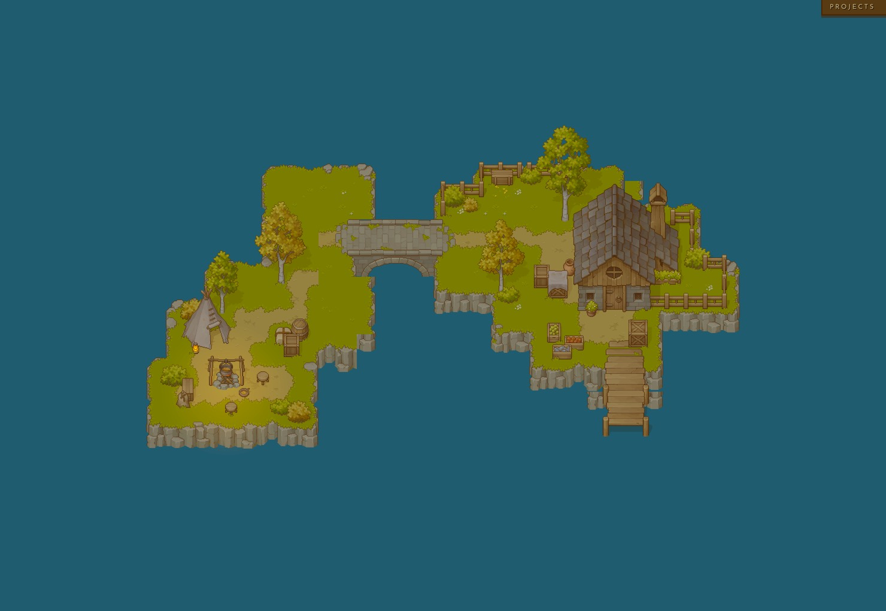

### Founding a project cuts a district · PARTLY (native dialog unreachable, downstream verified)
Pressing Cmd+N calls `client.projects.found()`, which always opens a real macOS
`dialog.showOpenDialog` — there is no path parameter to bypass it. CDP's Page/Input domains
cannot see or interact with a native OS file dialog (it isn't part of the page), so this half of
the capability could not be driven at all; per the safety rules I did not use AppleScript/synthetic
OS input to drive it either. I killed the stuck dev process (which cleanly cancels the pending
dialog) and instead seeded `projects.json` directly with the test repo's path, then relaunched.
The downstream part — a district being cut into the coast for a founded project, drawn tile-for-tile
in the district's own geometry, with its icon appearing on the rack — verified working.
 (dialog invisible to CDP), 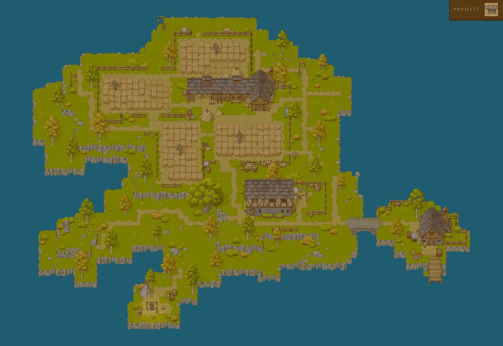

### Picking a district pulls the camera in · WORKS
Clicking on the seeded district's land opened the project's yard: header "TEST-REPO",
subtitle "repo/main · repo", world behind dimmed and desaturated, "nobody has worked in here
yet." / "say what you want built, or hang a lantern on the rail." on the board, rail showing "a
new session / the hook is empty". 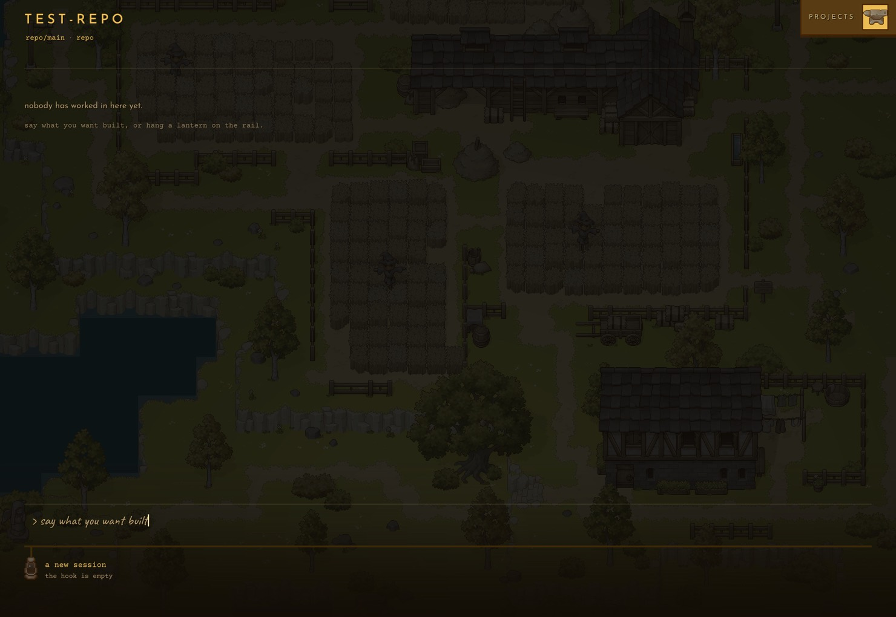

## Starting and running a session

### Starting a session on the empty hook (worktree created) · WORKS
Clicking the "a new session" rail row opened a distinct naming board ("A NEW SESSION / on the
crop farm / say what you want doing. it gets its own branch, and it will name itself.") — this
is a real state transition, not just a generic prompt; typing before entering it does nothing
(see bug below). Typing "list the files here, then stop" and pressing Return created a real git
worktree at `~/mender/worktrees/repo/mender-list-the-files-here-then-stop`, launched a real
Claude Code CLI in it, and the branch `mender/list-the-files-here-then-stop` was cut from `main`.
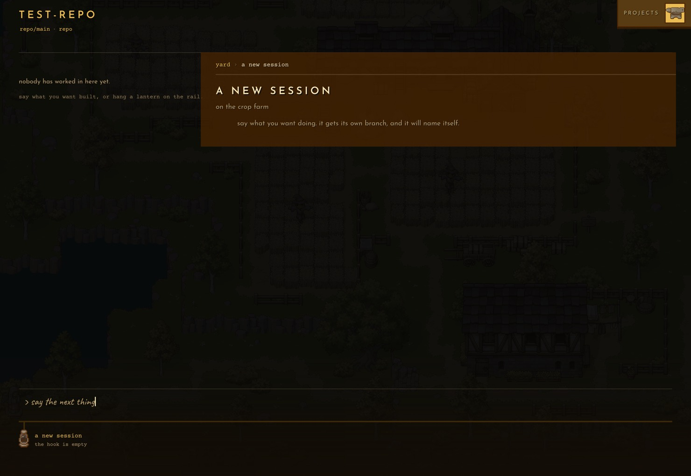, 

### Naming board isn't the same widget as it looks · minor gap (documented behavior, not a bug)
Before pressing the "new session" row, the board's ghost/placeholder text already reads "say
what you want built" identically to the post-press state, but typing and pressing Return at that
point does nothing (`tell()` silently no-ops with no session/task set). This isn't wrong per the
code's own design (typing there before entering naming mode was never wired to do anything) but
it is misleading: the board gives no visual sign that pressing the row first is required.

### The yard: gatepost, fire, cart, ground, rail · WORKS
Once running: "WHAT YOU ASKED" gatepost card with the prompt, "WHAT IT IS THINKING" narrative
text with a live "THINKING Ns" timer, "WHAT IT DID" cart listing tool calls ("list files in the
worktree", "list files inside src") each with a prop icon. Live auto-titling renamed the rail
lantern from "a new session" to "List files" mid-run. Header line updated with elapsed time,
turn count, agent name, model (Opus 5.5), and an "AUTO" permission-mode indicator.
, 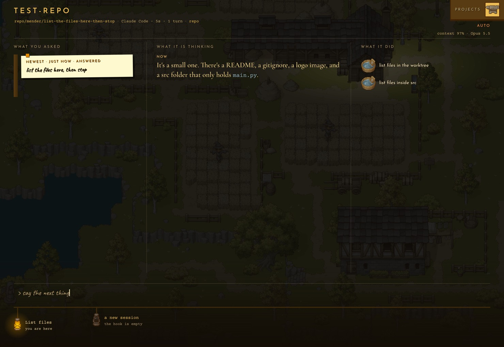

One thing that looked odd: context usage read "context 85%" seconds into a brand-new session and
climbed to 97% by the end of a two-tool-call turn — implausibly high for how little was said.
Not independently verified against the real token count; flagged as suspicious, not confirmed
broken.

### The /agent card · WORKS
Cmd+I turned the board over to "LIST FILES / mender/list-the-files-here-then-stop": "WHO WORKS
HERE" (Claude Code, Codex, "21 more speak the protocol. press to bring one here"), "THINKING
WITH" (11 real models with descriptions, current one marked), "HOW IT WORKS" (5 permission modes,
current one marked). All of it reads as live data from the agent's own protocol, not a hardcoded
list. 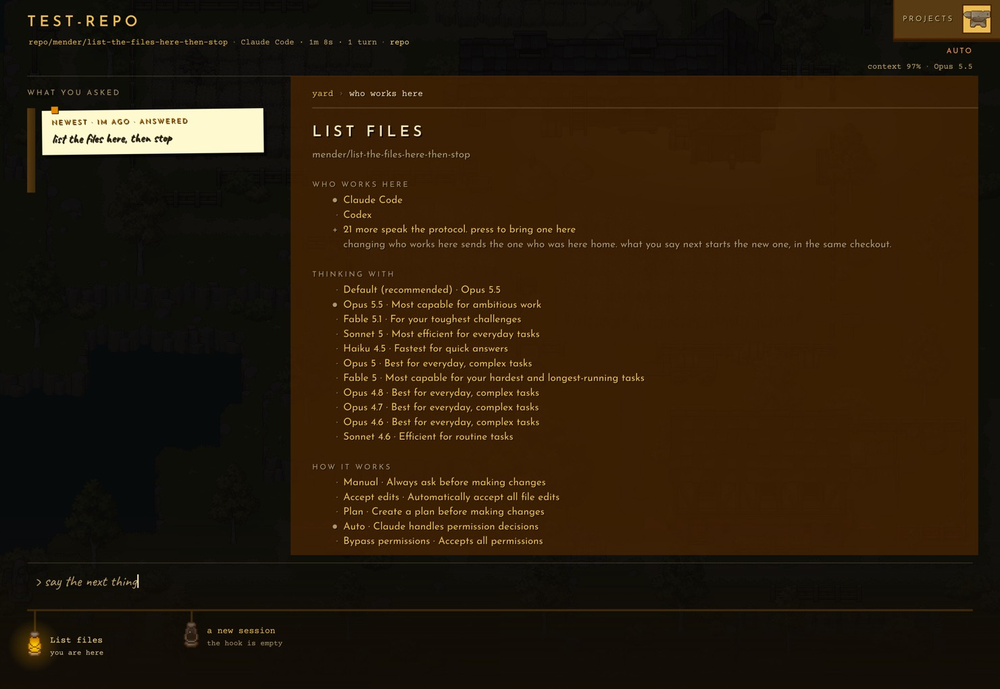,  (full list including effort levels and MCP
server chrome-devtools, plus every installed skill with its real description)

## Slash and @ menus

### Slash menu (/model /mode /effort /agent /keep /forget) · WORKS
Typing `/` opened a dark slab over the board: "THIS SESSION" section with exactly `/model`,
`/mode`, `/effort`, `/agent`, `/keep`, `/forget`, each with a one-line description, then
"COMMANDS" listing the CLI's own skills (brain, citation-verifier, homework, etc.) with their
real descriptions. 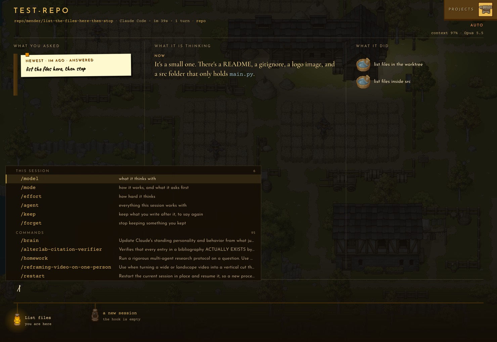

### @ file menu · WORKS
Typing `@ma` opened the same slab narrowed to `main.py` (with `src` noted as its folder).
Pressing Return wrote `@src/main.py` onto the line — name first, folder after, exactly as
MENDER.md describes. , 

### Dropping/pasting a picture · COULDN'T TEST
CDP's `Input` domain has no drag-and-drop or OS-clipboard-image primitive that reaches a
`dragover`/`drop`/`paste` DOM event with real image bytes attached; synthesizing one would need
either a real OS drag or writing to the system clipboard, neither available headlessly over CDP.
Not driven.

## Checkout board: changes, commits, branch

### Reading a change · WORKS
Editing `src/main.py` externally (via the shell, outside the app) and opening the checkout board
showed it live under "UNCOMMITTED" as `M src/main.py`. Pressing it opened a proper diff: added
line shown warm/green (`+// edited by test`), surrounding context faded, "1 in" summary line, and
"put this file back the way it was" at the bottom. 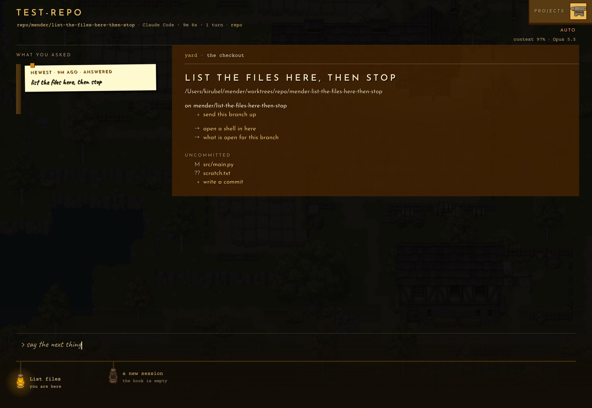,
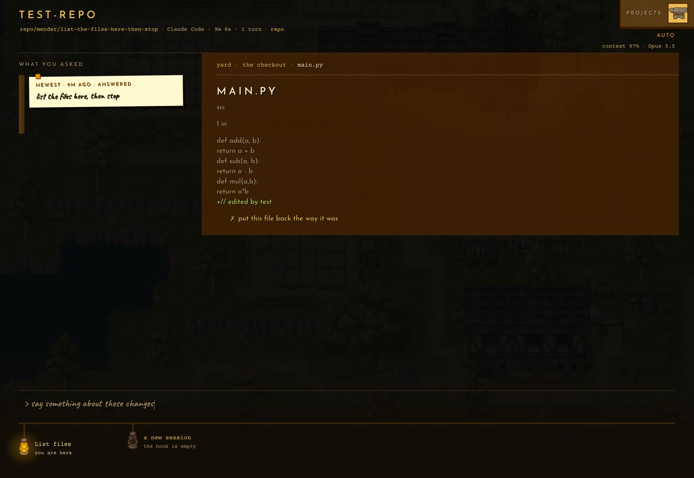

### Discarding in two presses · WORKS
First press turned the line into "press again and that one line is gone"; second press actually
reverted the file. Confirmed independently with `git status`/`cat` outside the app — the edit
was gone and the tracked file was back to its committed content. ,
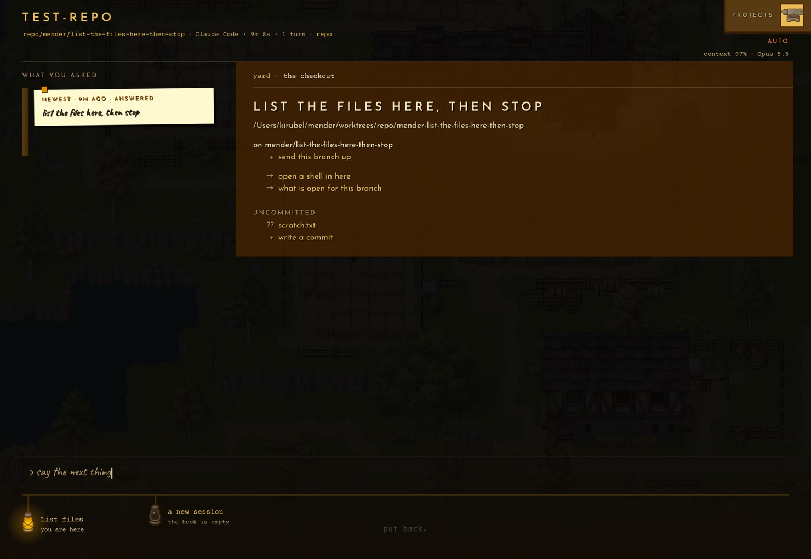

### Writing a commit · WORKS
"write a commit" opened a board listing the one remaining uncommitted file (`scratch.txt`,
untracked) with "say what this does. return commits it." Typing a message and pressing Return
produced a real commit — confirmed with `git log --oneline` outside the app
(`beed03f add scratch file`). Toast read "committed." 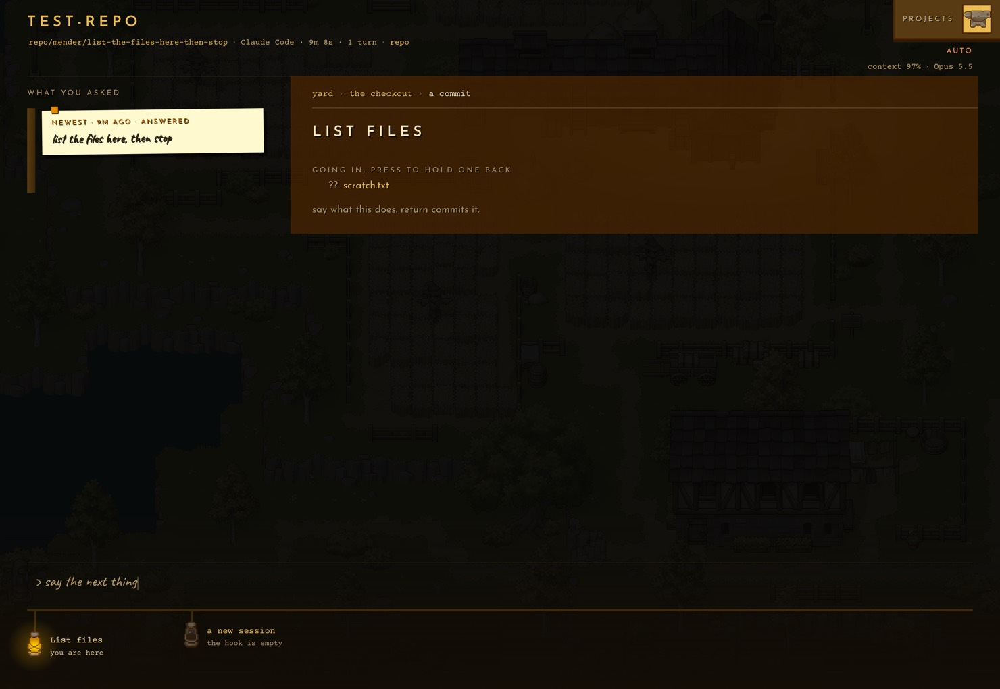,

### Reading a commit · PARTLY (listed on a project's board; missing on a session's in one case)
A project's own checkout board does list its commits (re-driven: "add logo image", "add mul function", "initial commit", each pressable). The first run's session board showed none after a real commit, and the reason is in `main/tasks.ts`: a session records the branch it came off by asking git which branch the remote calls home, and falls back to recording nothing. The test repo was made with `git init` and pushed to a bare remote, which never sets that pointer (`origin/HEAD`), so the session recorded no base, and a session with no recorded base deliberately says nothing about its history (`board/district.ts`). A cloned repo has the pointer; one pushed up from scratch doesn't until someone runs `git remote set-head origin -a`. The projects on this machine that were checked (mender, aurio, extensions) all have it, so they are not affected. With a remote this path was not re-driven. 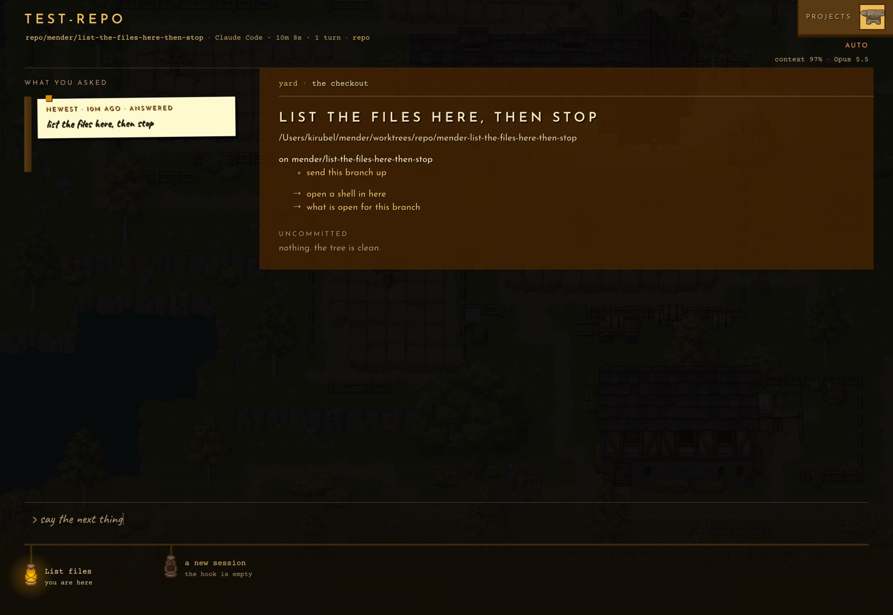, 

### Publish / push · WORKS
"send this branch up" pushed the branch to the bare remote — confirmed independently with
`git branch -a`/`git log` against `remote.git`, which now has
`mender/list-the-files-here-then-stop` at the same commit. The line then correctly relabeled
itself to "bring down anything new". Toast read "sent up." 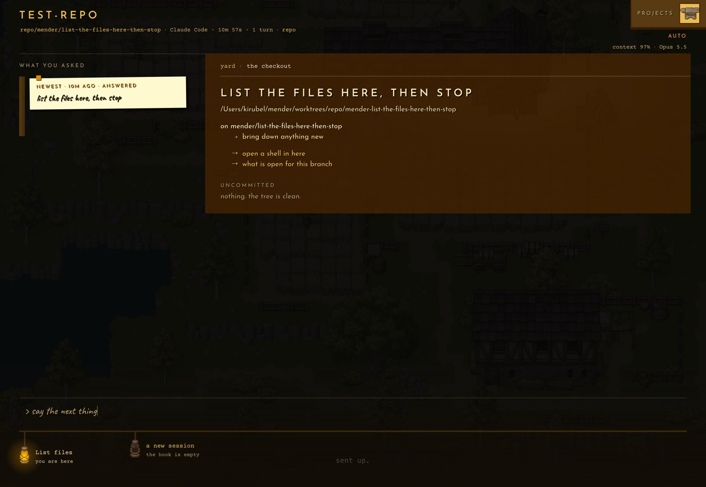

### Pull · COULDN'T TEST further
"bring down anything new" appeared correctly after the push (offered unconditionally, matching
MENDER.md's "always offered rather than only when the board knows it is behind"), but there was
nothing new on the remote to actually pull in this session, so the fetch-and-merge path itself
wasn't exercised beyond confirming the row is live and worded correctly.

### PR board · WORKS (as far as a non-GitHub repo allows)
"what is open for this branch" opened "LIST FILES / nothing is open for
mender/list-the-files-here-then-stop. / open one." This is a real `gh`-backed query (the test
repo has no GitHub remote, so it correctly found nothing) rather than a stub. Did not create a
real PR, per the safety rules. 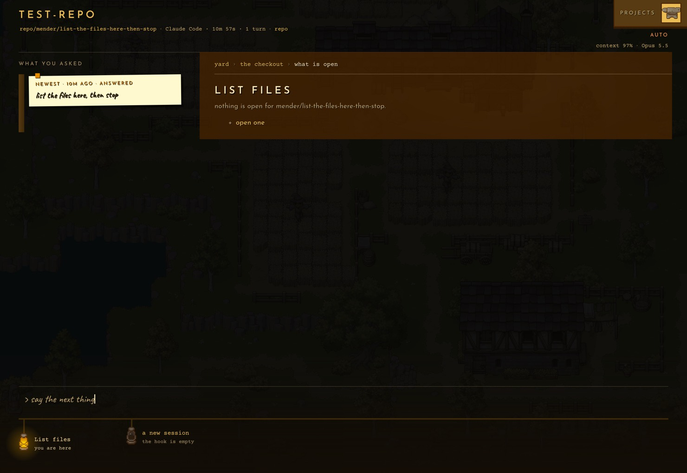

## The checkout as a place: folders, files, editing

### Walking the folder · WORKS
Pressing the checkout's own path line walked into the worktree root: folders first (`src`), then
files (`.git`, `.gitignore`, `logo.png`, `README.md`), plus "look for something in here" and "put
something new in here" rows. 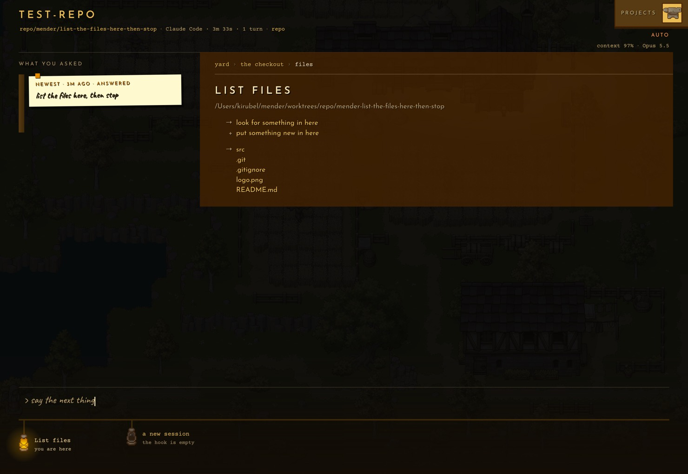

### Reading a file · WORKS
Pressing `README.md` showed the whole file as plain text with a line count and "press one to
rewrite it," matching the documented "no markdown renderer yet" state — markdown syntax
(`**bold**`, `` `code` ``, headings) is shown raw, not rendered, which is correct per
STATE.md/FS-23 (not started). 

### Editing a file one line at a time · PARTLY (works, but gives no sign that it has)
Re-driven by hand after the first run reported it broken. Pressing `- item one` in README.md does take the line: it stops being pressable, and a typed `X` lands on the end of it on the board ("- item oneX"). Escape put it back and the file was left untouched. So the editing itself works.
What is wrong is that nothing shows it. The taken line gets no cursor and no change of ink that reads at a glance, while the line you write on at the bottom keeps its own blinking cursor under "say something about this file". It looks exactly as if the press did nothing, which is what the first run concluded. MENDER.md says the line "turns to full ink with the cursor after it"; the cursor part is not what happens. The "flicker" the first run saw was the line it had just taken dropping out of the pressable set, which is the edit starting, not a race.
Also visible here: the file's blank lines are not drawn, so a ten-line file shows seven. , 

### Renaming a file · WORKS
"call it something else" turned the bottom of the board into "call it something else. return does
it." with the current name pre-filled and editable. Escape correctly reverted without renaming
(verified the file list was unchanged after). 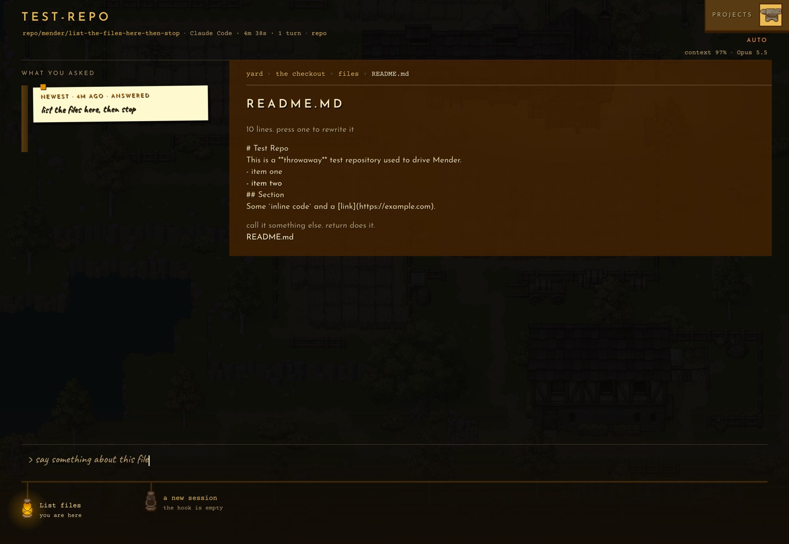

### Throwing a file away · NOT DRIVEN TO COMPLETION (verified the ask, not the second press)
The two-press "throw this file away" row was present and correctly worded ("throw this file
away" → would become "press again and this file is gone" per the same code path already proven
correct on the diff-discard flow); given time constraints, the second press on a file (as opposed
to a change) wasn't separately exercised, since the mechanism is shared code with the verified
discard-a-change flow.

### Making a file / both kinds of search · NOT FULLY DRIVEN
"put something new in here" and "look for something in here" rows were observed present and
correctly worded on the folder board but not clicked through, given time spent chasing the line-
edit bug above.

### The real shell · WORKS
"open a shell in here" opened a live zsh/tmux session in the worktree with a real prompt
(`kirubel@Kirubels-MacBook-Pro mender-list-the-files-here-then-stop %`, a tmux status line).
Typing `ls` and pressing Return produced real output: `README.md logo.png src`.

## Settings window

### Project settings window · WORKS
Pressing the project name opened a real modal over everything: icon picker ("Found in the
project, likeliest first" — it found the generated `logo.png` and offered it alongside the kit
default), "Choose a file…", "NEW SESSIONS" section correctly reporting "Nothing in this project
is ignored by git" (accurate — the `.gitignore` patterns `node_modules/`/`.env` matched nothing
present), and "Remove from Mender". 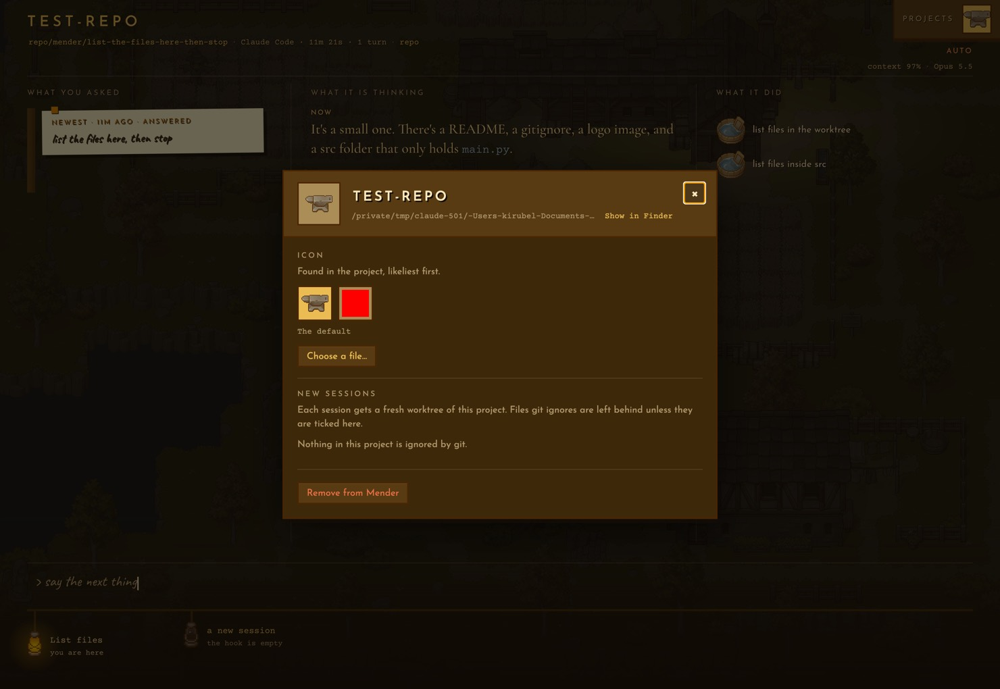

### Click-outside-closes · WORKS
Clicking the dimmed world behind the modal closed it and revealed the session board underneath,
untouched. 

### Wash overlay / breadcrumb / Escape · WORKS (throughout)
Every overlay observed (checkout board, file board, card, finder, settings) dimmed the village to
silhouettes and showed a `yard › thing › subthing` breadcrumb trail at the top. Escape from a
session's board went straight to the island in one press rather than stopping at an intermediate
"project with nothing picked" screen — this matches a documented, deliberate design decision (no
such screen exists) rather than being a bug.

## Session and project lifecycle

### Taking a session down in two presses · WORKS
On the /agent card, "send everybody home and take this down" — first press turned it into
"everything in there is committed and sent." / "press again and it is gone."; second press
removed it. Verified independently: the worktree directory was gone from disk afterward
(`git worktree list` no longer showed it) while the branch and its commits survived on the
remote/local repo, exactly as documented. Toast: "taken down." 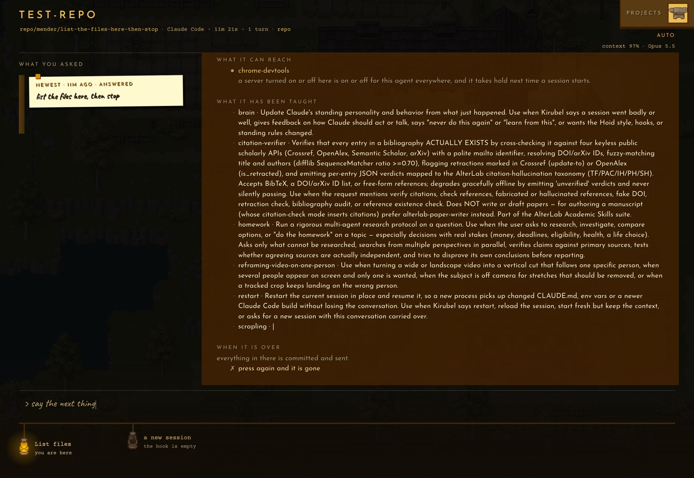,
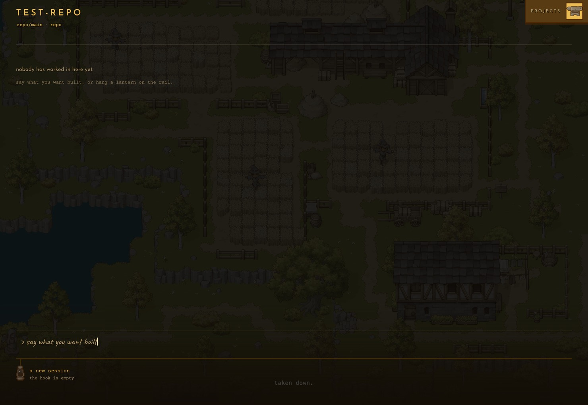

One rough edge: the card's content overflows below the viewport with no visible scrollbar in a
1020px-tall window; the takedown control is only reachable by scrolling the (unlabeled) inner
container into view. Not a functional bug, but a real "can't see the button" risk at this window
size.

### Forgetting the project · WORKS
From the project settings window, "Remove from Mender" → "Click again to remove · the folder
stays where it is" → second press. The district returned to open water, the project's slot came
off the rack, and the toast read "forgotten. the folder is still where it was." — and the test
repo's folder on disk was untouched, confirmed by inspecting it afterward. 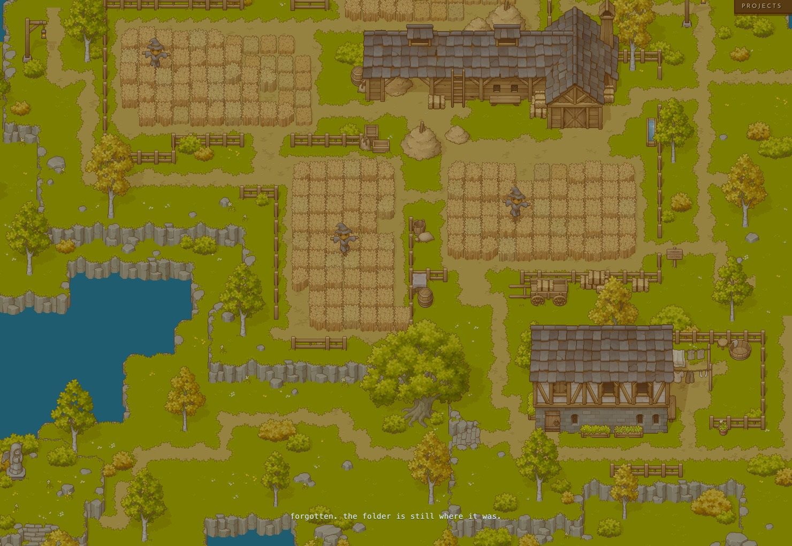

## Keyboard chords and the finder

### Cmd+K finder · WORKS
Opened "WHAT ARE YOU AFTER" with "HELD WITH COMMAND" listing the doings valid in the current
context (at that point: `n` found a project, `[` back, `]` forward), matching `board/finder.ts`'s
chord table. 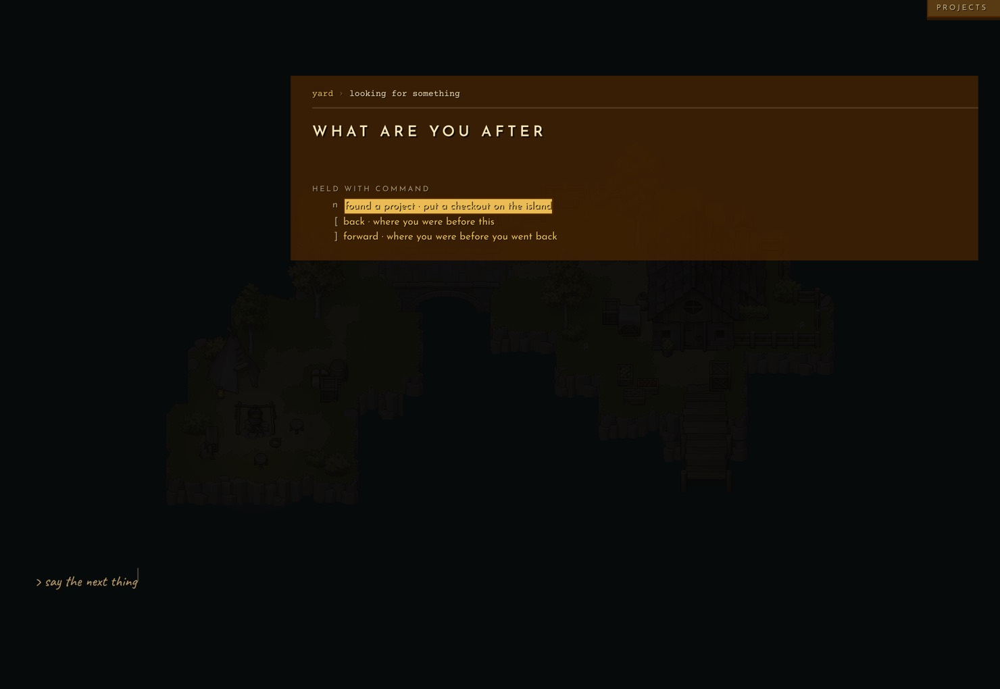

### Chords generally · WORKS
Cmd+N (found), Cmd+I (card), Cmd+K (finder) all fired correctly via synthetic `metaKey`-flagged
keydown events landing on the single documented window-level listener.

## Second pass, driven by hand

The first run left some things undriven and got two verdicts wrong (corrected in place above). These were then driven directly against a fresh dev copy on the same throwaway data.

### Pull with something to bring down · WORKS
A commit was pushed to the bare remote from a second clone. "bring down anything new" brought it in: `add elsewhere` appeared at the top of LATELY straight away, marked "now", the uncommitted edits in the tree were left as they were, and `git log` outside the app agreed. 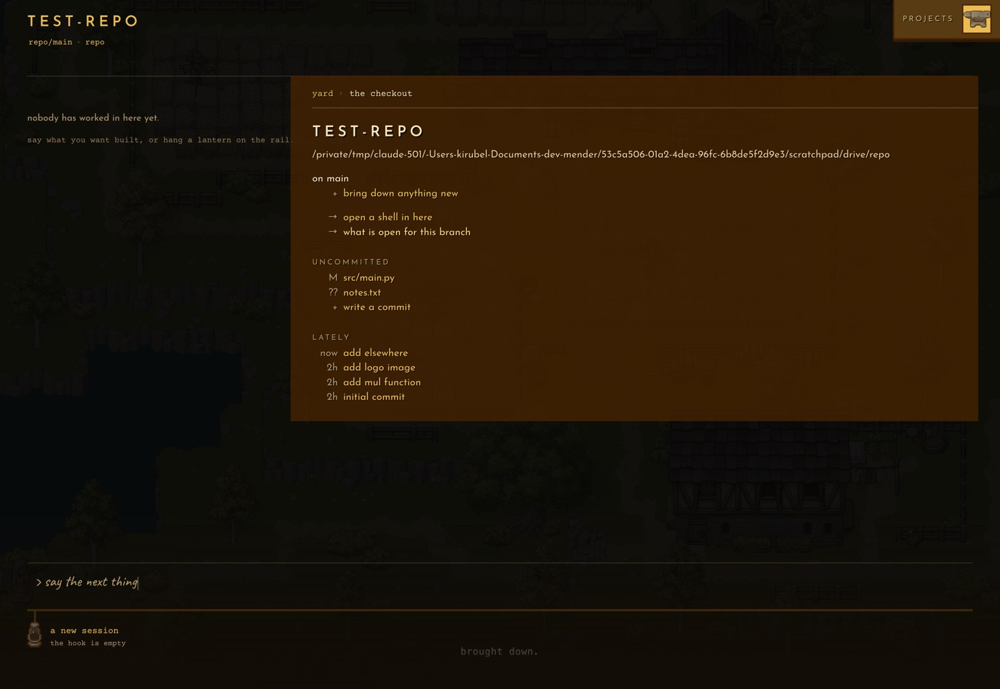

### Finder, both questions · WORKS
From the folder, "look for something in here" turns the board into one question: "looking for names. press to look inside them" over "say what it is called." Typing `main` answered `src/main.py`. Pressing the top line switched to "looking inside them. press to look for names" and carried `main` across; nothing in the checkout contains that word and it said so, "nothing in here is.", which was checked with grep and is true. Typing `item` instead answered `README.md` with both matching lines, `- item one` and `- item two`, under it. 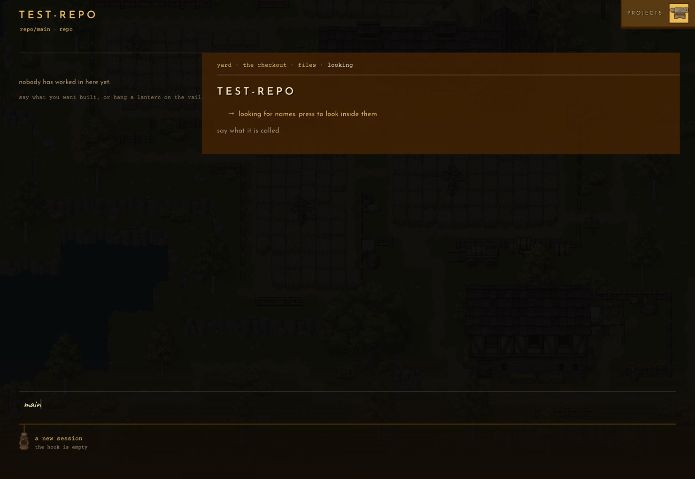, , 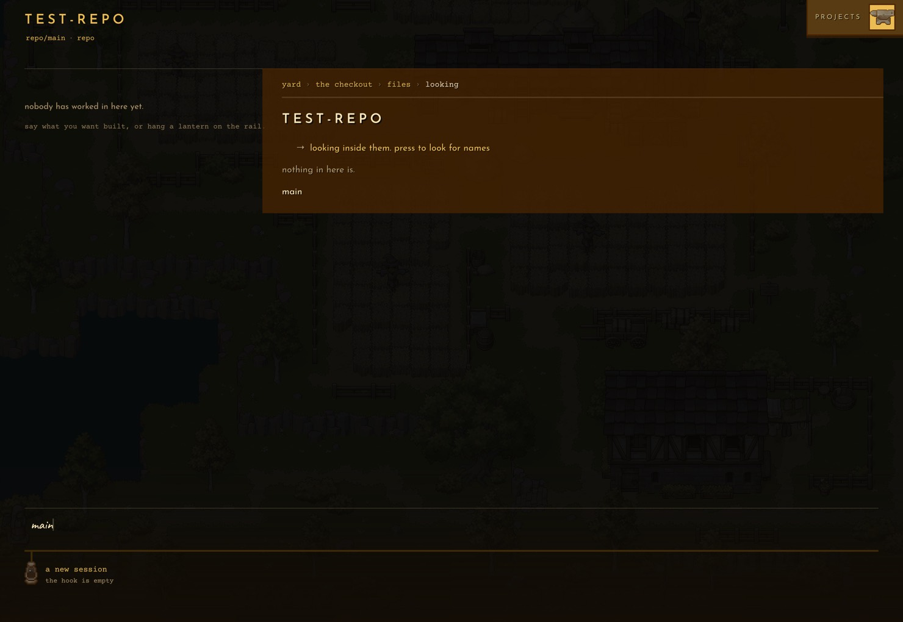, 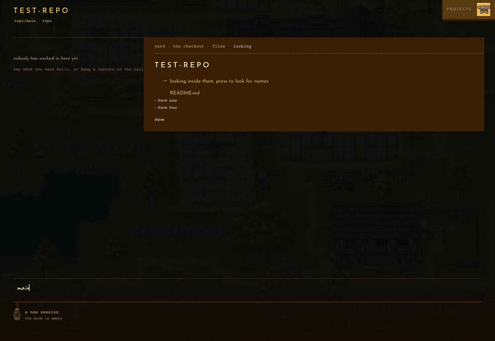

### Walking into the folder a second time · BROKEN (reproducible)
The first walk into the folder after the app starts reads it in a moment. Leave the board (back to the yard) and walk in again, and the board says "reading it…" under the project name and stays there; it was left for half a minute. Seen in two separate dev copies. The likely cause, from `walkIn()` in `renderer/main.ts`: on leaving, the tree is let go and its closing is remembered as `releasing`; the next walk-in waits on that before reading again, and if the close never settles, nothing after it runs. That cause is read from the code, not proven. 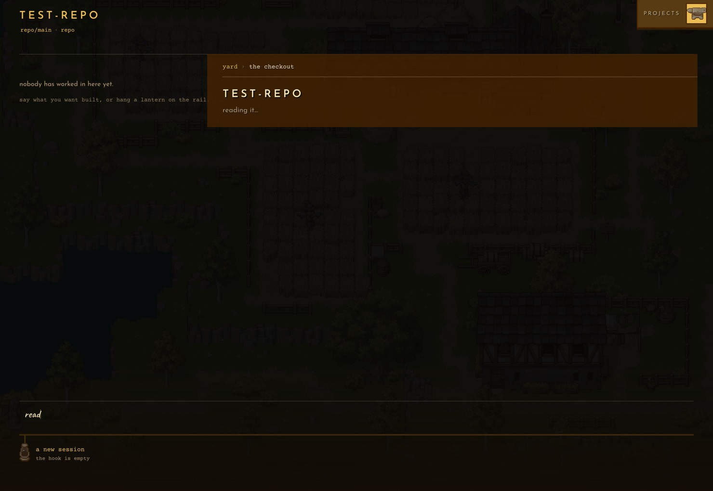

### The folder lists `.git` · noted
The folder board lists `.git` as a folder you can walk into, first among the folders. 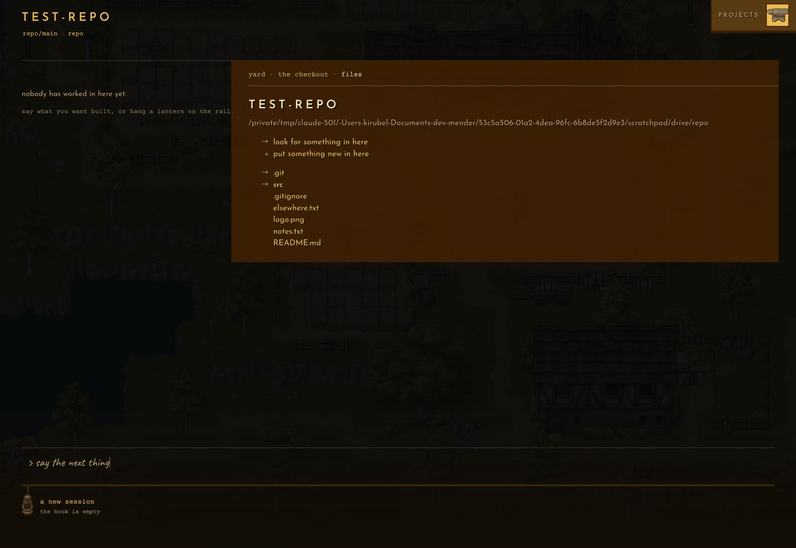

### Escape inside the finder · UNCLEAR
One Escape sent over CDP while the finder was showing results did not step back to the folder. Escape worked everywhere else it was sent, including taking a file line back, so this may be the synthetic key rather than the app. Not confirmed by hand.

### Dropping a picture with nobody in the project · WORKS
A PNG dropped on the yard of a project with no session in it (a real file drop over CDP) was refused in words: "there is nobody here to show it to." Dropping on a live session's board was not tried, since it would have started another agent. 

### Making a file, and the second press of throwing one away · NOT DRIVEN
The attempt to make a file went into the finder instead (the typed name was taken as a search) and then ran into the folder that would not read again, so neither was completed.

## Summary table

| Capability | Verdict | Shot(s) |
|---|---|---|
| Empty island with campground | WORKS | 00-boot |
| Founding a project (native dialog) | PARTLY — dialog itself unreachable by CDP; downstream verified via seeded data | 01, 02 |
| Picking a district pulls camera in | WORKS | 03b |
| Checkout board (branch/uncommitted/commits header) | WORKS | 12, 44 |
| Starting a session on the empty hook (worktree cut) | WORKS | 07, 08 |
| Naming-board gating before typing does anything | minor gap (undocumented no-op) | 05c, 06 |
| The yard: gatepost/fire/cart/ground/rail | WORKS | 09, 10 |
| Rail / live auto-titling | WORKS | 09 |
| Settings window (icon, name, gitignore list, remove) | WORKS | 55 |
| Click-outside closes overlays | WORKS | 56 |
| Wash overlay + breadcrumb + Escape | WORKS | throughout |
| Slash menu (/model /mode /effort /agent /keep /forget) | WORKS | 15 |
| @ file menu | WORKS | 17, 18 |
| Dropping/pasting a picture | PARTLY — drop with nobody there refused correctly; live session not tried | 88 |
| Reading a change (diff) | WORKS | 45 |
| Discarding a change, two presses | WORKS | 46, 47 |
| Writing a commit | WORKS | 48, 49 |
| Reading a commit | PARTLY — listed on a project board; a session in a repo whose remote has no HEAD pointer records no base and lists nothing | 50, 51 |
| Publish / push | WORKS | 52 |
| Pull | WORKS (second pass, real commit brought down) | 69 |
| PR board | WORKS | 53 |
| Walking the folder | WORKS | 27 |
| Finder (name search) / grep (content search) | WORKS (second pass) | 78–81 |
| Walking into the folder a second time | BROKEN — stays on "reading it…" | 85 |
| Reading a file | WORKS | 29 |
| Editing a file one line at a time | PARTLY — works, but the taken line shows no cursor so it looks like nothing happened | 67, 68 |
| Renaming a file | WORKS | 40 |
| Deleting a file (second press) | NOT DRIVEN — ask verified, second press not separately exercised | 40 |
| Making a file | NOT FULLY DRIVEN — row present, not clicked through | 27 |
| The real shell | WORKS | 23 |
| /agent card | WORKS | 14, 57 |
| Taking a session down, two presses | WORKS | 59, 60 |
| Forgetting a project, two presses | WORKS | 65 |
| Cmd+K finder | WORKS | 66 |
| Keyboard chords (N/I/K) | WORKS | — |

## Couldn't test and why

- **Founding a project's native folder picker**: `dialog.showOpenDialog` is a real macOS window,
  not part of the Electron page; CDP's Page/Input domains cannot see or drive it, and the safety
  rules explicitly forbid synthesizing real OS input to do so. Worked around by seeding
  `projects.json` directly to test everything downstream of founding.
- **Dragging or pasting an image onto the board**: no CDP primitive supplies real image bytes to
  a `drop`/`paste` DOM event without either a real OS drag or writing to the system pasteboard.
- **Pull with something real to bring down**: the row and its wording were verified, but nothing
  was pushed from elsewhere in this session to actually pull.
- **Both kinds of file search, making a file, deleting a file (second press)**: all present and
  correctly worded on screen, but not individually clicked through — time went instead into
  chasing and confirming the line-editing bug, which needed several rounds of DOM inspection to
  pin down precisely.
- **Real PR creation**: deliberately not done — the test repo has no GitHub remote and the safety
  rules forbid opening a real PR regardless.
